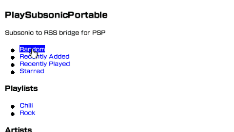

# 🔈 PlaySubsonicPortable

🎵 A tiny server that turns your Subsonic library into Sony PSP-compatible RSS feeds, allowing your PSP to become a
Subsonic streaming client, no custom firmware needed.

1. Open the PSP's Web Browser and navigate to this server's URL
2. Select the feeds to add to the RSS Channel (playlists, artists, random etc)
3. Open the PSP's RSS Channel, choose an installed channel, and start listening!



🧪 Tested on a PSP1000 running ARK-4 with a Navidrome server.

📶 Although you don't need custom firmware, it is recommended so that you can use the [WPA2 plugin](https://wololo.net/2025/02/14/the-20-year-old-psp-can-now-connect-to-wpa2-wifi-networks/) to connect to modern networks.

## Features

- Feeds for playlists, artists, recently added albums, recently played albums, most played albums, and random songs
- Easily browse available feeds from a web page in the PSP browser
- Cover art for feeds and individual songs
- All content transcoded to PSP-compatible mp3 on the fly by Subsonic
- Played songs are scrobbled back to Subsonic immediately on playback

## How to run

```bash
npm install
npm run build
```

```bash
PSSP_SUBSONIC_URL=http://<your-subsonic-host>:4533 \
PSSP_SUBSONIC_USER=<user> \
PSSP_SUBSONIC_PASSWORD=<password> \
npm run dev
```

Logs are emitted as JSON (request/response plus prewarm events) by default, which is useful for Docker or log aggregation. Set `PSSP_LOG_PLAIN=1` to get pretty-printed text instead, handy for local development:

```bash
PSSP_LOG_PLAIN=1 npm run dev
```

### Docker

```yaml
services:
  pssp:
    image: ghcr.io/adriankeenan/play-subsonic-portable:latest
    container_name: pssp
    restart: unless-stopped
    ports:
      - "7777:7777"
    environment:
      PSSP_PUBLIC_URL: http://<your-psp-host>:7777
      PSSP_SUBSONIC_URL: http://<your-subsonic-host>:4533
      PSSP_SUBSONIC_USER: <user>
      PSSP_SUBSONIC_PASSWORD: <password>
```

```bash
docker compose up -d --build
```

To run the image directly:

```bash
docker run -d --name pssp \
  -p 7777:7777 \
  -e PSSP_PUBLIC_URL=http://<your-psp-host>:7777 \
  -e PSSP_SUBSONIC_URL=http://<your-subsonic-host>:4533 \
  -e PSSP_SUBSONIC_USER=<user> \
  -e PSSP_SUBSONIC_PASSWORD=<password> \
  ghcr.io/adriankeenan/play-subsonic-portable:latest
```

## Configuration

ENV vars:

| Variable | Default | Purpose |
| --- | --- | --- |
| `PSSP_PORT` | `7777` | HTTP port to listen on |
| `PSSP_PUBLIC_URL` | auto-detected LAN IP | Base URL used in the page/feeds (set it if auto-detection picks the wrong address) |
| `PSSP_SUBSONIC_URL` | *(required)* | Base URL of your Subsonic server |
| `PSSP_SUBSONIC_USER` | *(required)* | Subsonic username |
| `PSSP_SUBSONIC_PASSWORD` | *(required)* | Subsonic password (remains on the server, not sent to PSP client) |
| `PSSP_SUBSONIC_TRANSCODE_BITRATE` | `256` | Transcode bitrate (kbps) for CBR mp3 stream |
| `PSSP_PREWARM_SONGS` | `3` | Number of upcoming feed tracks to pre-transcode in the background when a track is streamed (`0` disables) |
| `PSSP_SCROBBLE` | `1` | Scrobble played tracks to Subsonic immediately on playback (set `0` to disable) |
| `PSSP_LOG_PLAIN` | `0` | Emit logs as pretty-printed text (request, response, prewarm) instead of JSON when set to `1` |

## Notes

- We need to wait for transcoding to finish, between 5-10s, so that the entire content is available, otherwise the
  RSS channel will throw an error when requested http range is not returned. Subsonic servers usually have a cache,
  so this is only an issue on 'cold' playback. To mitigate the delay when moving to the next track, we pre-transcode
  the next upcoming tracks in the feed, so that they should be immediately available on current track finish.
- All feeds are capped at 100 items - this is a limitation of the PSP RSS reader.
- The RSS channel is designed to show audio articles ordered by publish date, therefore in order to maintain correct
  ordering, songs are returned in feeds with generated, meaningless publish dates.
- All content is served insecurely over HTTP, a limitation of the RSS channel (not that PSP supports modern HTTPS anyway).
- Subsonic does support videos, but these are silently dropped here. The goal here is streaming, and video in RSS feeds
  requires downloading in full before playing on PSP.
- So save on network requests, album art for each track is returned based on the album ID rather than the song ID. This
  may not be compatible with all subsonic implementations.
- It is assumed that all artwork is in JPEG format. Newer formats such as webp are not compatible and no conversion
  is applied.

## References

- [Guidelines for Creating Content for the PSP™ (PlayStation® Portable) RSS Channel](https://dn720700.ca.archive.org/0/items/psp-rss-guidelines/psp_rss.pdf)
